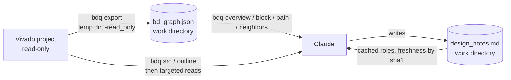

# vivado-bd-analyzer

A Claude Code skill that lets Claude explain
**Vivado block designs** and the RTL / Vitis HLS blocks inside them, while spending as
few tokens as possible. The Vivado project itself is never modified.

You ask *"what does `hdr_switch` do?"* or *"how does a packet get from the Ethernet input to QDMA?"*.
Claude doesn't need a screenshot of the schematic or a 5,000-line `write_bd_tcl` dump to answer. It
queries a local graph of the design, opens only the source lines that matter, and tells you which
parts of the answer it verified in code and which it inferred.

Screenshots lose the connections, `write_bd_tcl` dumps are mostly boilerplate, and whole source
trees are mostly irrelevant to any one question. This skill separates **storing** the design from
**looking at** it: the full design is exported once into a JSON graph that Claude never reads
directly, and a small CLI, `bdq`, returns only the slice a question needs.

## How it works



1. **Export (once per design change).** `bdq export` runs Vivado in batch mode and writes
   `bd_graph.json` with every cell, net, pin direction, clock/reset class, IP configuration and
   address segment. Hierarchies are flattened at query time, so routes cross them transparently.
2. **Query.** Claude maps your question to a query (`block`, `path`, `neighbors`, `clocks`, …).
   Each query prints a few lines of plain text.
3. **Read code only as far as needed.** For RTL and HLS blocks Claude goes from the graph to the
   source location, then to a structural outline with line numbers, then to only the relevant line
   ranges. Xilinx IP is explained from its documentation and configuration, never from source.
4. **Delegate big reads** to a subagent, keeping only its summary in the main context.
5. **Remember.** Explanations are saved as short notes with the sha1 of their sources. Later
   sessions reuse fresh notes and re-verify stale ones.

## Safety: read-only by design

The skill writes to **one folder**, the *work directory* you choose (e.g. `~/bdq/<project>`),
which holds `bdq.json`, the exported graphs and the notes, plus a small registry,
`~/.config/bdq/projects.json`, that maps each project to its work directory.

- **In code:** every write by `bdq` is refused outside the work directory, and inside the project
  if the work directory contains it.
- **In the export:** Vivado runs in a throw-away temp directory, receives the exporter on stdin and
  opens the project with `open_project -read_only`. If that fails, the export stops rather than
  opening the project writable.
- **In the instructions:** `SKILL.md` forbids Claude to touch anything outside the work directory;
  such changes are proposed to you instead.

For a hard guarantee, expose the project read-only (bind mount, or a user without write permission).

## Requirements

| Component | Version / notes |
|---|---|
| Claude Code | Any version with Agent Skills support |
| Python | 3.8+, standard library only |
| Vivado | A version whose `open_project` supports `-read_only` (UG835, 2023.x) |
| Shell | `bash` and `mktemp` (Linux/macOS) |

## Installation

Download `vivado-bd-analyzer.skill` from the [releases](../../releases) page (a zip of the
`vivado-bd-analyzer/` folder) and extract it into your personal skills folder:

```bash
rm -rf ~/.claude/skills/vivado-bd-analyzer          # remove a previous version, if any
unzip -o vivado-bd-analyzer.skill -d ~/.claude/skills/
```

From a clone, copy the skill folder instead:
`cp -r vivado-bd-analyzer/vivado-bd-analyzer ~/.claude/skills/`. Then restart Claude Code.

Optional: `alias bdq="python3 ~/.claude/skills/vivado-bd-analyzer/scripts/bdq.py"` to run the CLI
yourself, and copy `assets/hdl-reader.md` to `~/.claude/agents/` to install the subagent for large reads.

## Quick start

Open Claude Code in your project folder and ask about the design:

```text
What does hdr_switch do in the block design?
```

On the first run Claude asks for the work directory, the `.xpr` and block design to use and where
Vivado is installed, shows a dry run of the export, then runs it and saves the choices as a
profile. Later sessions skip the questions.

By hand:

```bash
bdq --workdir ~/bdq/proj --project-root ~/work/proj discover
bdq --workdir ~/bdq/proj --project-root ~/work/proj \
    export --xpr proj.xpr --bd pkt_proc --src-root src/rtl --src-root src/hls \
    --settings /tools/Xilinx/Vivado/2023.2/settings64.sh --save
bdq --config ~/bdq/proj/bdq.json overview
```

## Configuration

Everything lives in the work directory: `bdq.json`, one graph per block design under `graphs/`,
one notes file per profile, and a source index cache under `.cache/`. The first `export --save`
registers the project in `~/.config/bdq/projects.json`, so later runs inside the project find the
configuration without `--config`. Values resolve as
**command-line flags > active profile > top-level fields**, and a profile (usually one per block
design) only needs the fields that differ. `bdq config` shows what is active.

See [`assets/bdq.json.example`](vivado-bd-analyzer/assets/bdq.json.example) for a complete file and
[CLI.md](CLI.md#configuration-file) for every field.

## Working with Claude

| You ask | Claude starts with | Then |
|---|---|---|
| "What does `hdr_switch` do?" | `bdq block hdr_switch` | `src` → `outline` → reads only the select logic and FSM |
| "How does a packet get from the Ethernet input to QDMA?" | `bdq path S_AXIS_ETH M_AXIS_QDMA` | `block` on hops whose role is unclear |
| "What feeds `pe_0`?" | `bdq neighbors pe_0 --depth 2` | `block` on interesting neighbours |
| "Why does `pe_1` never leave reset?" | `bdq clocks pe_1` | the reset source (`proc_sys_reset` inputs) |
| "Which blocks access HBM?" | `bdq find hbm`, `bdq addr hbm` | `neighbors` through SmartConnects |
| "Explain the design" | `bdq overview` | main path between top-level ports; offers to go deeper |

Answers lead with the direct answer, then separate **verified** facts (with `file:line`) from
**inferences** drawn from names or connectivity:

> `hdr_switch` routes each packet to `pe_0` or `pe_1`. The destination is
> `s_axis_tdata[8 +: SEL_W]` (verified, `src/rtl/hdr_switch.sv:36-38`), and packets whose first
> byte is `0xFF` go to the `DROP` state until `tlast` (verified, lines 25-34). Dropped packets
> appear to be consumed at line rate (inferred; `tready` handling not read).

What Claude learns is saved in the notes file, one Markdown section per block
([format](vivado-bd-analyzer/assets/design_notes.example.md)). A note is *fresh* while its sources
keep the recorded sha1, and *stale* (re-verified before use) once they change. Its `Role:` line
appears in `bdq overview`.

The full `bdq` reference is in [CLI.md](CLI.md). The graph schema and export internals are in
[`references/export.md`](vivado-bd-analyzer/references/export.md).

## Troubleshooting

| Symptom | Likely cause / fix |
|---|---|
| `bdq: command not found` | It is a script: use `python3 …/scripts/bdq.py` or define the alias |
| `no configuration found for …` | First setup: pass `--workdir` and `--project-root` to the first `export --save`. An existing setup: `bdq --config <dir>/bdq.json config --register` |
| `refusing to write outside the work directory` | `--out` or the configuration points outside the work directory |
| `refusing to write inside the project` | The work directory is the project root or contains it: move `bdq.json` to a dedicated folder and set `project_root` |
| `vivado: command not found` | Set `vivado.settings` to your `settings64.sh` |
| `export timed out` | Raise `--timeout` or `vivado.timeout` |
| `cannot open '…' read-only` | Your Vivado doesn't support `open_project -read_only`, or the path is wrong |
| No batch Vivado available | In the Vivado Tcl console: `source …/scripts/bd_export.tcl; bdx_export <workdir>/graphs/bd_graph_<bd>.json` (a GUI session may save project state on its own) |
| `WARNING: the .bd file is newer than bd_graph.json` | The design changed: run `bdq export` again |
| Connections with empty source or destination | A pin property differs in your Vivado version: see `references/export.md` |
| Clock/reset nets shown as data | RTL pins lack `X_INTERFACE_INFO` clock/reset attributes |
| `no source found` for a block | Top module name differs from the VLNV name, or it is outside `src_roots`: add a `src_map` entry |
| Export is very slow | HBM/DDR/PCIe/QDMA IPs: set `vivado.skip_config` (e.g. `"*hbm*"`) |

## Limitations

- **Testing status.** Tried on synthetic designs and against a mocked Vivado Tcl API, not yet across
  many real projects and Vivado versions. Reports from real designs are very welcome.
- **The outline is regex-based**, not a full HDL parser: heavy macros, `` `ifdef ``s, complex
  `generate` blocks or SystemVerilog interfaces can be partially missed. VHDL support is basic.
- **Linux/macOS only** for the export command. **One block design per graph** (use profiles).
- **Generated-file detection** is heuristic (HLS output folders, "Generated by Vitis HLS" headers).

## Contributing

Issues and pull requests are welcome, especially Vivado version reports, outline improvements and
real-world routing examples for `references/routing.md`. Keep `bdq.py` dependency-free and
compatible with Python 3.8, and keep every write behind `assert_writable()`. CI runs
`uvx ruff check .` and a Python 3.8–3.13 syntax check; pushing a `v*` tag publishes the `.skill`
file as a release (`zip -r vivado-bd-analyzer.skill vivado-bd-analyzer -x '*__pycache__*'`).
